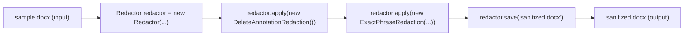

# Remove Hidden Text and Comments from Word Documents using GroupDocs Redaction for Java

This repository demonstrates how to remove hidden text and comments from a Word document before sharing it with external parties using GroupDocs Redaction for Java. The specialized redaction engine supports multiple document formats and compliance-oriented features to sanitize sensitive content reliably.

## Problem
When sharing Word documents externally, hidden text, tracked changes, and annotations (comments) may inadvertently expose internal notes, draft content, or personally identifiable information. Manual review is time-consuming and error-prone.

## What This Example Shows
This example uses GroupDocs Redaction for Java to:
- Automatically delete all annotations (comments) from a Word document
- Replace exact sensitive phrases (e.g., "Confidential", "Internal") with placeholder text
- Save the sanitized document to a new file

The result is a clean, production-ready document ready for external distribution.

## How it works



**Important:** Ensure your input file (`sample.docx`) exists in `src/main/resources/input/` before running. The demo uses `sample.docx` as the default input.

## Topics covered
Remove hidden text and comments from a Word document before sharing it with external parties.

## Prerequisites
- Java 8 or higher
- Maven 3.x

## License
GroupDocs Redaction for Java requires a license for production use. You can:
- [Request a free 30-day Temporary License](https://purchase.groupdocs.com/temporary-license)
- [Purchase a license](https://purchase.groupdocs.com/buy)

## Setup & Run

1. Clone this repository.
2. Place a sample Word document at `src/main/resources/input/sample.docx`.
3. Run:
   ```bash
   mvn compile exec:java
   ```

The sanitized output will be saved to `src/main/resources/output/sanitized.docx`.

## FAQ

**Q: Does this example redact tracked changes?**
A: No. This example removes annotations and exact phrases. To redact tracked changes, use `DeleteAnnotationRedaction` with additional filtering or combine with metadata redactions.

**Q: Can I redact comments by author or content pattern?**
A: Yes. Use `RegexRedaction` or `DeleteAnnotationRedaction` with a regex pattern to target specific comments.

**Q: Is the output document still editable?**
A: Yes. The output remains a standard `.docx` file, but all redacted content is permanently removed.

## Documentation
For full details, see the [GroupDocs Redaction for Java Documentation](https://docs.groupdocs.com/redaction/java/).

## Demo Entry Point
See `src/main/java/com/groupdocs/redaction/examples/RemoveHiddenTextCommentsWordExample.java`. The `run()` method is written as **Steps 1–4** with comments explaining each operation.